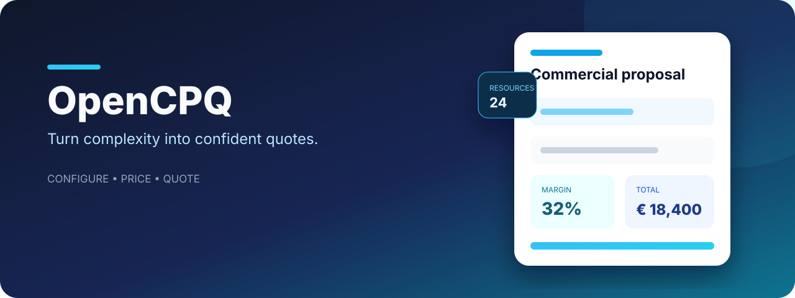
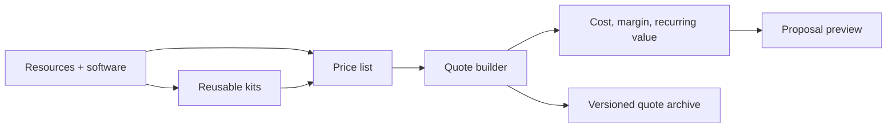

<p align="center">
  
</p>

<p align="center">
  A modern Configure, Price, Quote workspace for turning reusable costs, products, and services into consistent commercial proposals.
</p>

<p align="center">
  <a href="https://react.dev/"></a>
  <a href="https://www.typescriptlang.org/"></a>
  <a href="https://firebase.google.com/"></a>
  <a href="https://vite.dev/"></a>
</p>

## Quoting should be a system, not a spreadsheet ritual

OpenCPQ brings the moving parts of a commercial proposal into one focused workspace. Teams can define reusable resources and price-list items, compose them into offers, inspect margin and recurring revenue, and preserve a searchable history of quote versions.

The project explores how a lightweight CPQ product can make pricing logic visible instead of burying it inside copied files and manual formulas.

### Core capabilities

- **Resource catalog** for materials, labor, software assets, and reusable cost inputs.
- **Price-list management** with categories and optional customer-specific pricing.
- **Composite components** for packaging multiple resources into reusable kits.
- **Guided quote builder** with quantities, unit costs, markup, fixed prices, and billing frequency.
- **Commercial metrics** including total cost, price, recurring value, and margin percentage.
- **Quote lifecycle** with status, origin, validity, delivery date, payment terms, and version history.
- **Dashboard and archive** for finding offers and understanding commercial activity.
- **Print-ready proposal preview** for turning structured data into a client-facing document.

## Product model



## Why the architecture stays approachable

| Concern | Approach |
|---|---|
| UI and workflow | React components organized around quoting tasks |
| Domain safety | Shared TypeScript models for resources, items, and quotes |
| Authentication | Firebase Authentication |
| Persistence | Cloud Firestore |
| Visualization | Recharts dashboards |
| Deployment | Static Vite build with environment-based configuration |

## Quick start

Requirements:

- Node.js 18 or newer
- A Firebase project with Authentication and Firestore enabled

```bash
git clone https://github.com/ChronoSLM/open-cpq.git
cd open-cpq
npm install
cp .env.example .env.local
npm run dev
```

Populate `.env.local` with your own Firebase web application configuration.

## Secure by default

> [!IMPORTANT]
> The included Firestore rules deny all access. Define and test an authorization model for your organization before enabling persistence.

No production credentials, backend identifiers, customer records, or database exports are included in this repository.

Never commit:

- `.env.local` or environment-specific configuration;
- Firebase service-account keys;
- customer names, pricing, or quote exports;
- production database snapshots;
- API secrets of any kind.

Firebase web configuration is visible to browser clients by design. Real authorization must be enforced through Authentication, Security Rules, and App Check.

## Project map

```text
src/components/       quoting workflows and reusable UI
src/contexts/         application settings
src/services/         Firebase configuration and data access
src/types.ts          shared CPQ domain models
firebase-blueprint.json
firestore.rules       deny-all public template
```

## Verification

```bash
npm run lint
npm run build
```

## Project status

OpenCPQ is a sanitized public portfolio project and a foundation for further CPQ experiments. Before production use, add an organization-aware authorization model, validation rules, audit logging, automated tests, and deployment-specific compliance controls.

If structured pricing systems are your kind of problem, star the repository and explore the domain model.
